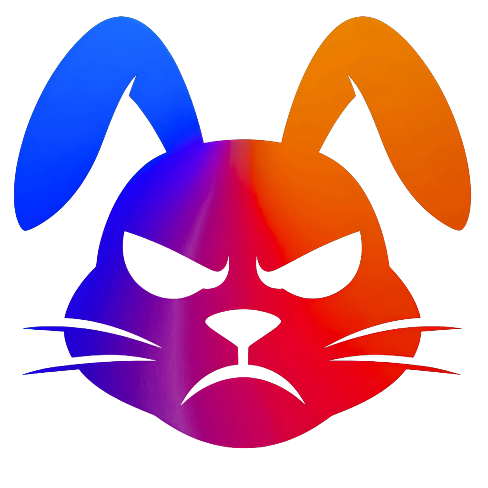
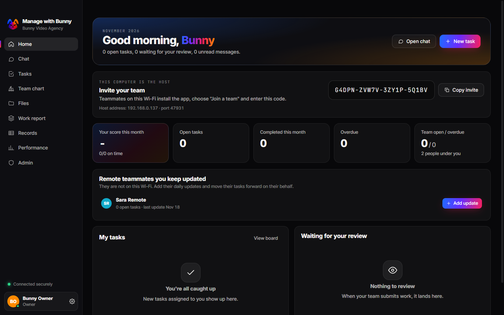
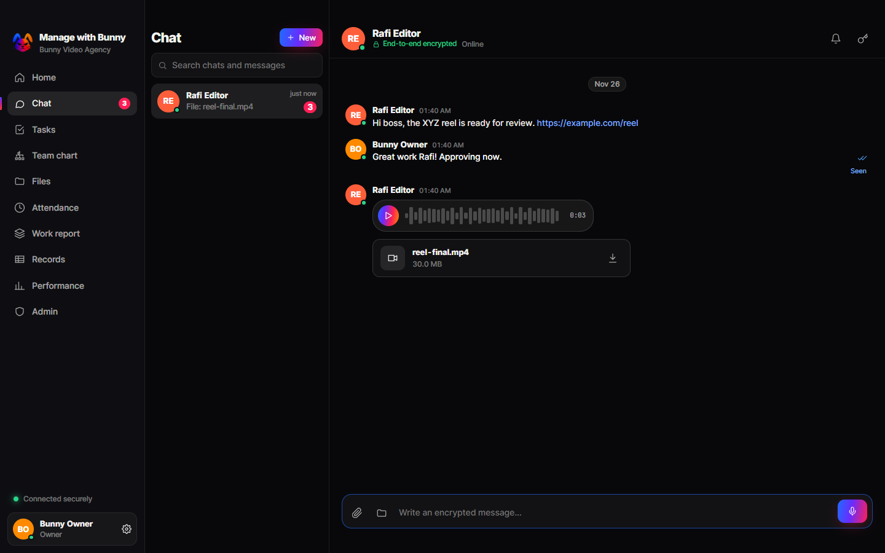
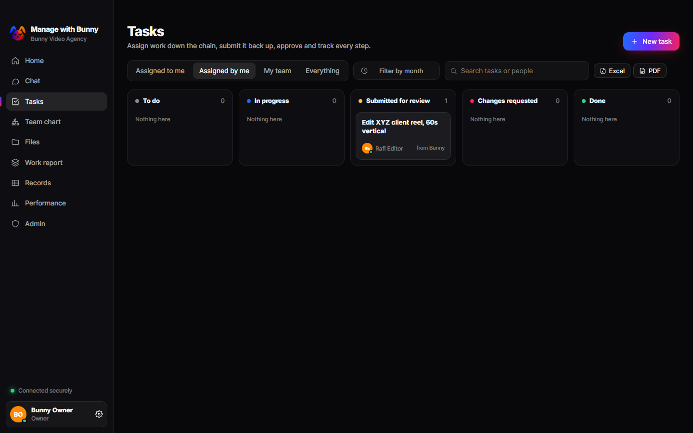
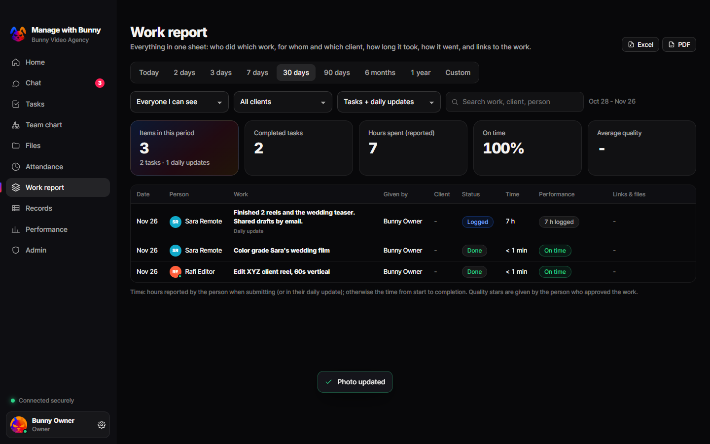
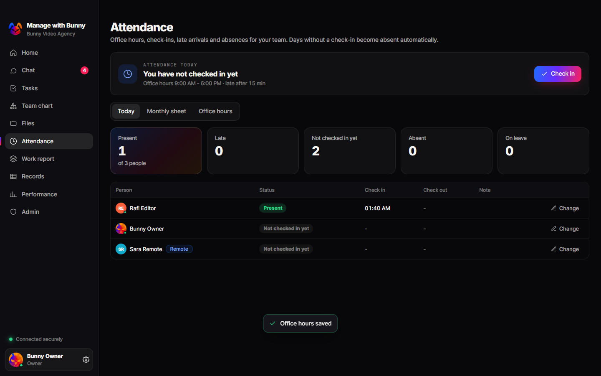
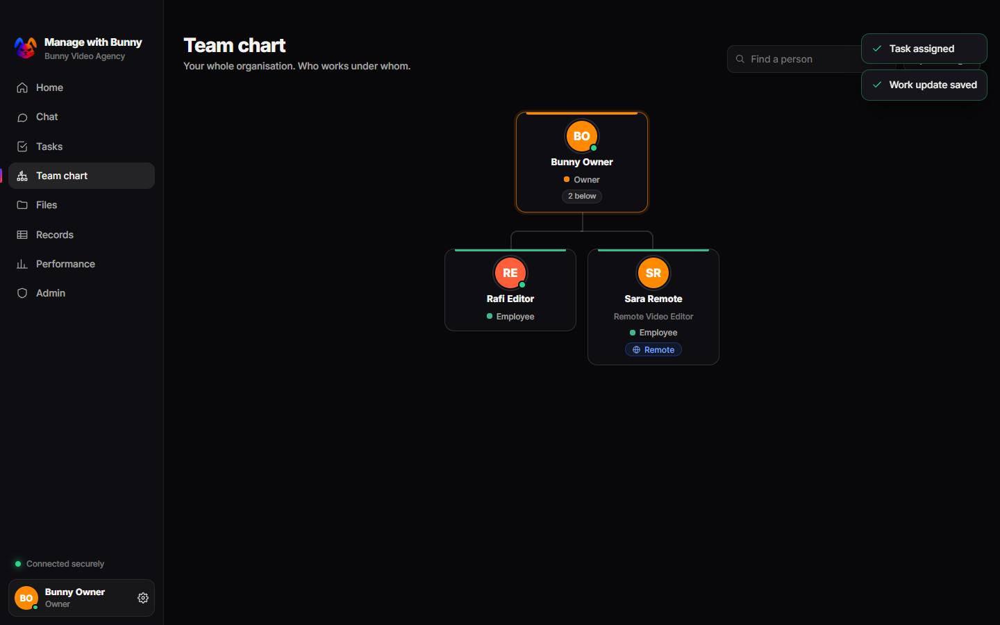

<p align="center">
  
</p>

<h1 align="center">Manage with Bunny</h1>

<p align="center">
  <b>Private team chat, file sharing, tasks, attendance and performance tracking, running entirely on your own Wi-Fi.</b><br>
  Nothing goes to the internet or to a cloud service.
</p>

<p align="center">
  <a href="https://github.com/uday629/manage-with-bunny/releases/latest"><b>Download</b></a> ·
  <a href="https://uday629.github.io/manage-with-bunny/">Guide (website)</a> ·
  <a href="https://uday629.github.io/manage-with-bunny/UI.html">Screen tour</a> ·
  <a href="#faq">FAQ</a>
</p>

<p align="center">
  Made by <b>Bunnys Framelab</b> · <a href="https://framelabmedia.odoo.com/">framelabmedia.odoo.com</a> · <a href="https://www.instagram.com/bunnysframelab/">@bunnysframelab</a>
</p>

---

## Contents

- [What it does](#what-it-does)
- [Screenshots](#screenshots)
- [Requirements](#requirements)
- [Install](#install)
- [Set up your team](#set-up-your-team)
- [Daily use](#daily-use)
- [Uninstall](#uninstall)
- [Troubleshooting](#troubleshooting)
- [Limitations](#limitations)
- [Security](#security)
- [FAQ](#faq)
- [Build from source](#build-from-source)
- [License](#license)

---

## What it does

One computer in your office becomes the **host**. Everyone else installs the app, joins with a code, and is approved by the owner. All messages, files and data are stored on the host, and move only inside your own network.

| Area | What you get |
|---|---|
| **Chat** | Direct messages (end-to-end encrypted), group chats, voice messages, replies, edits, search (Bengali and English), seen / not seen ticks, typing indicator |
| **Files & folders** | Send any file or a whole folder, LocalSend-style. Receivers see live progress, then preview images, videos and audio in the chat or download. Folders arrive as a `.zip`. Resumes after a Wi-Fi drop |
| **Tasks** | Assign down the chain, delegate subtasks, submit with files and hours, request changes, approve with quality stars. Full history |
| **Work report** | One sheet of tasks and daily updates for today, 2 / 3 / 7 / 30 / 90 days, 6 months, 1 year or any custom range. Excel and PDF export |
| **Attendance** | Office hours, check in / check out (host clock), late and absent detection, leave, half day, holidays, monthly sheet with attendance % |
| **Team** | Team chart, roles with 13 permissions, 17 ready-made positions, custom positions, remote teammates kept up to date by a caretaker |
| **Records** | Private sheets (hiring, expenses, leads, work handed out) shared only with people you choose. CSV, Excel and PDF export |
| **Performance** | Monthly score per person, on-time rate, overdue work, hours logged, manager reviews, 12-month history |
| **Admin** | Join approvals, storage report and cleanup, daily backups, move storage to another drive, security log, network check |

---

## Screenshots

| Home | Chat |
|---|---|
|  |  |
| **Tasks** | **Work report** |
|  |  |
| **Attendance** | **Team chart** |
|  |  |

More screens (files, records, performance, storage, roles, settings) are in [`UI.html`](UI.html) and in the [screen tour](https://uday629.github.io/manage-with-bunny/UI.html).

---

## Requirements

| | Windows | Mac |
|---|---|---|
| **System** | Windows 10 or 11, 64-bit | macOS 12 or newer. Apple Silicon (M1–M4) or Intel |
| **Disk space** | About 400 MB for the app, plus room for the team's files on the host | Same |
| **Permission** | Administrator approval once, to install | Drag to Applications |
| **Network** | Everyone on the same Wi-Fi or office network | Same |
| **Optional** | Microphone for voice messages | Microphone for voice messages |

**Host computer:** keep it switched on during work hours. Use a drive with plenty of free space for files and videos. A drive other than C: is best.

**Network:** guest Wi-Fi usually blocks devices from seeing each other, so use the main office network. No internet connection is needed after you download the app.

---

## Install

Download **one file**: `Manage-with-Bunny-<version>-Complete.zip` from the [Releases page](https://github.com/uday629/manage-with-bunny/releases/latest). It contains both installers and the offline guide.

1. Right-click the ZIP and choose **Extract All**.
2. Open the folder you get. Then:
   - **Windows:** open `Windows/` and double-click `Manage-with-Bunny-Setup-<version>.exe`.
   - **Mac:** open `Mac (Apple Silicon)/` for M1–M4, or `Mac (Intel)/` for Intel. Double-click the `.dmg` and drag the app into **Applications**.
3. Open `README.html` from the same folder for the full step-by-step guide.

Each release also lists the installers separately, and `SHA256SUMS.txt` lets you check the files.

**First run:**
- **Windows:** if "Windows protected your PC" appears, click **More info**, then **Run anyway**. Windows shows this because the app is not code-signed yet.
- **Mac:** right-click the app, choose **Open**, then **Open** again. If macOS still refuses, go to System Settings → Privacy & Security and click **Open Anyway**.
- Allow **Local Network** access when asked. Allow **Microphone** only if you want voice messages.

**Updating:** install the new version over the old one. Your account and all data stay.

---

## Set up your team

1. **Pick the host.** Choose the computer that stays on during work hours. Open the app there and choose **Host a workspace**.
2. **Create the workspace.** Enter the workspace name, your name, a username and a strong password. Pick the storage folder (a drive other than C: is suggested).
3. **Invite people.** On the Home screen press **Copy invite**. It copies the join code and the host address together, so joining works even where discovery is blocked. Send it to your team.
4. **Teammates join.** Each person installs the app, chooses **Join a team**, pastes the invite and creates their own password. The app checks the host's identity before it sends anything.
5. **Approve.** The owner (or anyone with the approve permission) gets a notification in Admin. Approve each person, choose their position (Manager, Employee, Video Editor, …) and who they report to. That builds the team chart.

> **Keep passwords safe.** Private messages are encrypted with your password. If it is lost, an admin can create a one-time reset code, but older private messages can no longer be read. That is what keeps them private.

---

## Daily use

- **Chat:** click **New** to start a direct message or a group. Click the microphone to send a voice message. Drag a file or folder into the chat to send it.
- **Attendance:** press **Check in** on Home when you arrive and **Check out** when you leave. Your check-in time comes from the host computer.
- **Tasks:** the person doing the work presses **Start**, attaches the result and presses **Submit**. The person who assigned it approves or asks for changes.
- **Work report:** pick a period, filter by person or client, and export to Excel or PDF.

Full details for every feature are in [README.html](README.html).

---

## Uninstall

- **Windows:** quit the app from the tray icon. Then go to **Settings → Apps → Installed apps**, choose **Manage with Bunny** and click **Uninstall**. This removes the app, its shortcuts, its firewall rule and its start-with-Windows entry.
- **Mac:** quit from the menu-bar icon. Drag the app from **Applications** to the **Trash**. Remove it from **System Settings → General → Login Items** if it is listed.

Your workspace data is **never deleted automatically**. On the host, the storage folder you chose stays on the disk. Delete it yourself only if you are sure.

---

## Troubleshooting

| Problem | What to do |
|---|---|
| **"Could not reach the host"** | Check that the host computer is on and the app is open there. Both computers must use the same Wi-Fi. Open **Settings → Network check** and follow its advice. |
| **Joining fails on the office Wi-Fi** | The router may have *AP isolation* or *client isolation* turned on. Use the main network, or turn that option off in the router. Then paste the full invite (code and address) when joining. |
| **Windows Firewall blocks the app** | Open **Settings → Network check** and press **Fix it**. Windows will ask for permission once. |
| **A file shows "changed or was moved on disk"** | The file was edited or moved after you chose it. Pick it again. |
| **A folder shows "could not be read"** | Drag the folder into the chat instead of using the folder button. On a Mac, allow the app in **Privacy & Security → Files and Folders**. |
| **Voice message does not record (Mac)** | Allow Microphone for the app in **System Settings → Privacy & Security → Microphone**. |
| **Asked to sign in again after a power cut** | Enter your password once. You stay signed in after that. |

Still stuck? Open an issue on this repository and include the **Network check** result (no passwords or personal data).

---

## Limitations

- Works only on the **same local network**. There is no access from the internet. People who work away from the office use **remote profiles**: a caretaker keeps their tasks and daily updates up to date.
- The **host must be on** for anyone to send or receive. Nothing is lost while it is off, and everyone reconnects by themselves when it is back.
- **One host** per workspace. There is no automatic second host.
- No **voice or video calls** and no screen sharing.
- **Windows and Mac only.** No mobile app, no Linux build.
- **No automatic updates.** Download new versions yourself.
- Group data and files are **not encrypted on the host's disk**. Turn on **BitLocker** (Windows) or **FileVault** (Mac) on the host.
- The installers are **not code-signed** yet, so Windows and macOS warn on first run.
- The app has been tested with two app copies on one Windows PC, with 15 people at the same time, and with a year of data. Larger teams should work but are not measured. The Mac version passes its automated tests on GitHub's Mac machines, but it has not yet been run on a real Mac by the authors.

---

## Security

- All traffic is encrypted with **TLS 1.3**. The app checks the host's certificate fingerprint before it sends anything, so a fake host on the same Wi-Fi cannot take over.
- Passwords are hashed with **Argon2id** on the device; the password itself never leaves your computer.
- **Direct messages** are end-to-end encrypted (X25519 key exchange, AES-256-GCM). The host stores only scrambled data.
- Every request is checked on the host against roles, the reporting chain and resource ownership.
- Testing: 179 API and security tests, a 56-case internal penetration test (all attacks blocked), 64 end-to-end app tests, and two independent QA reviews. **No outside company has audited the app.**
- To report a security problem, contact Bunnys Framelab through the website above. Please do not post exploit details in a public issue.

---

## FAQ

**Who is it for?** Small and medium teams that want chat, files, tasks and attendance without a cloud account, and whose work stays inside one office or one Wi-Fi.

**Does it need the internet?** Only to download the app. Everything after that runs on your network.

**Can my team use it from home?** Not directly, since it is local-only. Use remote profiles so their work is still tracked, or use a VPN into the office network if your IT allows it.

**What happens if the host computer breaks?** Restore the storage folder from a backup on a new computer. Make backups from **Admin → Storage → Back up now**, and copy the storage folder to another drive regularly.

**Can I copy or change the code?** Not without permission. See the license below.

---

## Build from source

```bash
npm install
npm start                 # run in development
npm run typecheck
npm run test:server       # API and security tests
npm run test:pentest      # internal penetration test
npm run test:load         # load and data-volume tests
node build.mjs --dev && node tests/e2e.mjs   # UI tests (Windows)
npm run dist:win          # Windows installer into release/
npm run dist:mac          # Mac DMGs (on a Mac)
```

Pushing a version tag such as `v1.4.0` runs [`.github/workflows/build.yml`](.github/workflows/build.yml). It builds the Windows and Mac installers on clean machines, creates the complete ZIP and publishes the release.

**Stack:** Electron, React, TypeScript, esbuild, SQLite built into Node (`node:sqlite`, no native modules), `ws` and `hash-wasm`.

---

## License

Copyright © 2026 Bunnys Framelab. All rights reserved.

No open-source license is granted yet. You may download and use the app. Reusing or changing the code needs permission from Bunnys Framelab.
